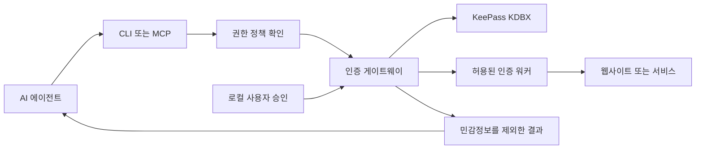

<div align="center">
  

  # keepass-agent

  **로그인은 AI 에이전트에게 맡기고, 비밀번호는 보호하세요.**

  기존 KeePass 저장소를 AI 에이전트에 연결하는 로컬 인증 게이트웨이입니다.
  비밀번호를 직접 전달하는 대신, 허용된 로그인 작업만 실행하도록 설계했습니다.

  📖 **[문서 사이트](https://cngjsskaisme.github.io/keepass-for-agents/ko/)** — 가장 읽기 편한 가이드 (한국어 · English)

  [빠른 시작](docs/ko/quickstart.md) · [MCP 연결](docs/ko/mcp.md) · [보안과 한계](docs/ko/security.md) · [English](README.md)
</div>

---

## 왜 필요한가요?

AI 에이전트가 웹사이트에 로그인하려면 계정 정보가 필요할 수 있습니다. 하지만 비밀번호를 프롬프트나 도구 응답, 설정 파일에 그대로 넣는 것은 불필요한 노출 위험을 만듭니다.

**keepass-agent는 비밀번호를 조회하는 대신 인증 작업을 요청하도록 합니다.** 기존 KeePass 데이터베이스를 활용하고, 등록된 인증 워커에만 필요한 정보를 전달한 다음 민감정보가 제외된 결과를 반환합니다.

### 주요 기능

| | 제공 기능 |
| --- | --- |
| 🔐 **기존 KeePass 활용** | `.kdbx` 파일을 새로운 클라우드 서비스로 옮기지 않고 연결합니다. |
| 🤖 **CLI·MCP 지원** | AI 에이전트가 계정 검색과 로그인 작업을 요청할 수 있습니다. 비밀번호 조회용 MCP 도구는 제공하지 않습니다. |
| 🧭 **접근 권한 설정** | 에이전트별 작업·계정·접속 대상 호스트를 제한합니다. |
| ✅ **사용자 잠금 해제** | 마스터 비밀번호는 AI 채팅이 아닌 로컬 브라우저에서 입력합니다. |
| 🛡️ **선택형 격리 모드** | Hardened Mode에서는 인증정보 처리를 별도 OS 서비스 계정으로 분리할 수 있습니다. |
| 📋 **사용 내역·관리** | 요청 기록, 세션, 권한 정책, 처리 결과를 확인합니다. |

## 어떻게 동작하나요?



에이전트에는 계정 메타데이터와 상태, 승인된 작업의 결과만 전달합니다. `get_password`와 같은 비밀번호 조회 도구는 제공하지 않습니다. 실제 보안 범위는 [보안과 한계](docs/ko/security.md)를 확인하세요.

## 빠른 시작

**준비 사항**

- **Windows:** Node.js 22.18 이상(또는 23.6 이상), KeePass 2.x, KPScript. 계정 생성·수정에는 Python 3.10 이상과 PyKeePass도 필요합니다.
- **Linux:** Node.js 22.18 이상(또는 23.6 이상), Python 3.10 이상, PyKeePass.
- 기존 `.kdbx` 파일. 처음에는 **테스트용 저장소**를 권장합니다.

KeePass와 KPScript는 별도로 설치해야 하며 프로젝트에 포함되지 않습니다. [설치 가이드](docs/ko/installation.md)와 [Windows 준비 안내](docs/ko/keepass-binaries.md)를 참고하세요.

### 1. 저장소 내려받기 및 설치

```bash
git clone --branch feat/keepass-for-agents --single-branch https://github.com/cngjsskaisme/nougat-worker.git
cd nougat-worker
```

**Windows (PowerShell):**

```powershell
powershell -NoProfile -ExecutionPolicy Bypass -File .\tools\install.ps1 -DryRun
powershell -NoProfile -ExecutionPolicy Bypass -File .\tools\install.ps1
```

**Linux:**

```bash
bash tools/install.sh --dry-run
bash tools/install.sh
```

설치 후 환경을 확인합니다.

```bash
node src/cli/kp.ts doctor
```

### 2. KeePass 저장소 연결

```bash
# 경로를 실제 KDBX 파일 위치로 변경하세요.
node src/cli/kp.ts db add personal --path "/path/to/personal.kdbx"
```

### 3. **에이전트 연결 전** 접근 권한 줄이기

> [!IMPORTANT]
> 최초 설정은 사용 편의를 위해 `agents.default.allowed = ["*"]`로 시작합니다. **AI 에이전트에 사용하기에는 안전한 기본 권한이 아닙니다.** 허용할 작업·계정·사이트를 먼저 제한하세요.

기본적인 기능 확인을 위한 예시입니다.

```bash
node src/cli/kp.ts config set agents.default.allowed "db.list,db.info,unlock,status,search,login,lock"
node src/cli/kp.ts config validate
```

실사용 시에는 에이전트별 정책을 만들고 `allowed_entries`, `allowed_hosts`도 제한하세요. [설정과 접근 권한](docs/ko/configuration.md)을 참고하세요.

### 4. 잠금 해제·계정 검색·잠금

```bash
node src/cli/kp.ts unlock --db personal
# 마스터 비밀번호는 로컬 브라우저 페이지에서 입력합니다.
node src/cli/kp.ts search --db personal --title "예시 계정"
node src/cli/kp.ts lock --db personal
```

검색 결과에는 **계정 메타데이터**만 포함되며 비밀번호 원문은 반환되지 않습니다. 검색 제목은 실제 저장된 계정명으로 바꾸세요.

## MCP로 AI 에이전트 연결

로컬 stdio MCP 서버를 지원합니다. 아래는 **일반적인 설정 예시**이며, 사용하는 MCP 클라이언트에 따라 설정 위치와 형식이 달라질 수 있습니다.

```json
{
  "mcpServers": {
    "keepass-agent": {
      "command": "node",
      "args": ["/absolute/path/to/nougat-worker/src/mcp/server.ts"],
      "env": {
        "KEEPASS_AGENT_ID": "assistant"
      }
    }
  }
}
```

`assistant`에는 필요한 작업과 계정, 호스트만 허용하세요. **Standard Mode의 Agent ID는 호출자가 선언하는 값이며 강하게 인증된 신원이 아닙니다.** MCP 설정에 마스터 비밀번호나 API Key를 넣지 마세요.

주요 도구는 `session_status`, `request_unlock`, `search_entries`, `request_login`, `logout`, `revoke_session`, `audit_tail`입니다. 클라이언트 연결과 브라우저 로그인 준비 사항은 [MCP 연결 가이드](docs/ko/mcp.md)에서 확인하세요.

## 보안 모델과 한계

| | Standard Mode | Hardened Mode |
| --- | --- | --- |
| 일반 에이전트 응답에 비밀번호 반환 | API 설계상 제외 | API 설계상 제외 |
| KDBX 접근 | 에이전트와 같은 OS 사용자 | 별도 Credential Service 계정 |
| 같은 사용자 권한의 악성 프로세스 격리 | **불가능** | OS 권한을 올바르게 구성한 경우 격리 |
| 준비 | 기본 설치 | 별도 서비스·ACL·IPC 설정 필요 |
| Credential Service 연결 실패 | 해당 없음 | 자동으로 Standard Mode로 전환하지 않고 실패 |

**주의할 한계:** 로컬 브라우저 승인만으로 실제 사람이 승인했음을 증명할 수 없고, Standard Mode의 에이전트 이름은 자기 선언 방식입니다. 일부 플랫폼의 OS 수준 호출 주체 확인은 아직 완전하지 않습니다. 워커 출력 필터링 역시 인코딩·변형된 모든 비밀정보를 탐지한다고 보장하지 않습니다. 세션 쿠키도 비밀번호와 같은 수준으로 보호해야 합니다.

**실제 계정을 연결하기 전에는 테스트 계정으로 먼저 검증하세요.** OS 권한 분리와 접속 대상, 정책을 사용 환경에서 확인해야 합니다. [보안 모델](docs/ko/security.md)과 [운영 가이드](docs/ko/operations.md)를 참고하세요.

## 개발 및 문서

```bash
npm ci
npm run typecheck
npm test
npm run docs:dev
```

일부 통합 테스트는 KeePass/KPScript 또는 브라우저가 설치되지 않으면 건너뛸 수 있습니다. 단위 테스트 통과만으로 실제 OS 계정 격리나 외부 사이트 로그인 안정성이 보장되지는 않습니다.

| 문서 | 한국어 | English |
| --- | --- | --- |
| 시작하기 | [빠른 시작](docs/ko/quickstart.md) | [Quick start](docs/quickstart.md) |
| AI 에이전트 연결 | [MCP 연결](docs/ko/mcp.md) | [MCP](docs/mcp.md) |
| 명령어 | [CLI 명령어](docs/ko/cli.md) | [CLI reference](docs/cli.md) |
| 권한 설정 | [설정과 접근 권한](docs/ko/configuration.md) | [Configuration](docs/configuration.md) |
| 보안 | [보안과 한계](docs/ko/security.md) | [Security & limitations](docs/security.md) |
| 오류 해결 | [문제 해결](docs/ko/troubleshooting.md) | [Troubleshooting](docs/troubleshooting.md) |

기여를 환영합니다. 인증정보, 권한 정책, 워커, IPC를 수정할 경우 회귀 테스트를 추가하고 실제 인증정보가 코드나 로그에 포함되지 않도록 주의해 주세요.

## 라이선스

이 프로젝트는 [MIT 라이선스](LICENSE)를 따릅니다. **KeePass와 KPScript는 별도 라이선스가 적용되는 외부 소프트웨어**이며 이 저장소에 포함되지 않습니다.
