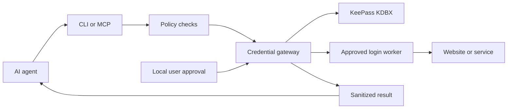

<div align="center">
  

  # keepass-agent

  **Let AI agents sign in. Keep your passwords out of their responses.**

  A local, KeePass-backed credential gateway for AI agents.
  Connect an existing KDBX database, approve authentication tasks, and use the gateway through CLI or MCP.

  [**Quick start**](docs/quickstart.md) · [**MCP setup**](docs/mcp.md) · [**Security & limits**](docs/security.md) · [**한국어**](README.ko.md)
</div>

---

## Why keepass-agent?

AI agents often need to sign in to websites or services. Giving an agent a password through a prompt, tool response, or configuration file creates unnecessary exposure.

**keepass-agent lets an agent request an authentication task, rather than retrieve a password.** It reuses your existing KeePass database and passes credentials to an allowlisted authentication worker, returning a sanitized outcome instead of the secret.

### At a glance

| | What you get |
| --- | --- |
| 🔐 **Bring your KeePass database** | Use an existing `.kdbx` file without moving credentials to a cloud password manager. |
| 🤖 **Agent-friendly interface** | CLI commands and a local stdio MCP server. No password-retrieval MCP tool. |
| 🧭 **Access policies** | Limit actions, account entries, and destination hosts for each declared agent. |
| ✅ **User-controlled unlock** | Enter the master password on a local browser page, never in the AI prompt. |
| 🛡️ **Optional isolation** | Hardened Mode moves credential work to a separately provisioned OS service account. |
| 📋 **Audit and management** | Review requests, session state, policies, and outcomes. |

## How it works



Your agent gets metadata, status information, and authorized task outcomes. It does **not** get a `get_password` tool. See [Security & limitations](docs/security.md) for what this does—and does not—protect.

## Quick start

**Requirements**

- **Windows:** Node.js 22.18+ (or 23.6+), KeePass 2.x and KPScript; Python 3.10+ with PyKeePass for creating or editing entries.
- **Linux:** Node.js 22.18+ (or 23.6+), Python 3.10+ and PyKeePass.
- An existing `.kdbx` database (preferably a **test database** for your first run).

KeePass and KPScript are installed separately and are **not bundled**. See [installation](docs/installation.md) and [Windows KeePass setup](docs/keepass-binaries.md).

### 1. Download and install

```bash
git clone --branch feat/keepass-for-agents --single-branch https://github.com/cngjsskaisme/nougat-worker.git
cd nougat-worker
```

**Windows (PowerShell):**

```powershell
powershell -NoProfile -ExecutionPolicy Bypass -File .\tools\install.ps1 -DryRun
powershell -NoProfile -ExecutionPolicy Bypass -File .\tools\install.ps1
```

**Linux:**

```bash
bash tools/install.sh --dry-run
bash tools/install.sh
```

Then check the environment:

```bash
node src/cli/kp.ts doctor
```

### 2. Connect your KeePass database

```bash
# Replace the path with your own existing KDBX file.
node src/cli/kp.ts db add personal --path "/path/to/personal.kdbx"
```

### 3. Review permissions **before connecting an agent**

> [!IMPORTANT]
> The initial configuration currently sets `agents.default.allowed = ["*"]` for first-run convenience. **This is not a secure default for AI agents.** Restrict the permitted actions, entries, and hosts before adding an AI client.

For a basic local walkthrough, you can reduce the default action list:

```bash
node src/cli/kp.ts config set agents.default.allowed "db.list,db.info,unlock,status,search,login,lock"
node src/cli/kp.ts config validate
```

For real use, create an agent-specific policy and restrict `allowed_entries` and `allowed_hosts`. See [configuration](docs/configuration.md).

### 4. Unlock, search, and lock

```bash
node src/cli/kp.ts unlock --db personal
# Enter your master password in the local browser page.
node src/cli/kp.ts search --db personal --title "Example account"
node src/cli/kp.ts lock --db personal
```

The search returns **account metadata**, not the password. Replace the example entry title with one in your own database.

## Connect an AI agent with MCP

Use the local stdio MCP adapter with an MCP-capable client. The configuration below is **generic**; your client may use different configuration keys or locations.

```json
{
  "mcpServers": {
    "keepass-agent": {
      "command": "node",
      "args": ["/absolute/path/to/nougat-worker/src/mcp/server.ts"],
      "env": {
        "KEEPASS_AGENT_ID": "assistant"
      }
    }
  }
}
```

Give the `assistant` identity only the actions, entries, and hosts it needs. **Agent IDs are caller-declared, not authenticated identities in Standard Mode.** Never place a master password or API key in MCP configuration.

Available tools include `session_status`, `request_unlock`, `search_entries`, `request_login`, `logout`, `revoke_session`, and `audit_tail`. For client setup and the browser-login prerequisites, see the [MCP guide](docs/mcp.md).

## Security: know the boundary

| | Standard Mode | Hardened Mode |
| --- | --- | --- |
| Passwords in normal agent-facing results | Excluded by API design | Excluded by API design |
| KDBX access | Same OS user as the agent | Separate credential service account |
| Protection from a malicious same-user process | **No** | OS isolation, **if correctly provisioned** |
| Setup | Basic installation | Additional service, ACL, and IPC setup |
| On unavailable credential service | N/A | Fail closed; no silent fallback |

**Important limitations:** Browser approval is not proof that a human approved the action; agent identities in Standard Mode are self-declared; and OS peer-identity verification is not complete on every platform. Worker output filtering is a defense-in-depth measure, not a guarantee against every form of encoded or transformed secret. Treat session cookies as credentials.

**Use test accounts first.** Before connecting sensitive accounts, verify permissions and the isolation boundary in your actual environment. Read the full [security model](docs/security.md) and [operations guide](docs/operations.md).

## Development & documentation

```bash
npm ci
npm run typecheck
npm test
npm run docs:dev
```

Some integration tests need KeePass/KPScript or a configured browser and may be skipped when those dependencies are absent. Passing unit tests alone does not demonstrate OS-account isolation or real-site login reliability.

| Guide | English | 한국어 |
| --- | --- | --- |
| Getting started | [Quick start](docs/quickstart.md) | [빠른 시작](docs/ko/quickstart.md) |
| AI agent integration | [MCP](docs/mcp.md) | [MCP 연결](docs/ko/mcp.md) |
| Commands | [CLI reference](docs/cli.md) | [CLI 명령어](docs/ko/cli.md) |
| Permissions | [Configuration](docs/configuration.md) | [설정과 접근 권한](docs/ko/configuration.md) |
| Security | [Security & limitations](docs/security.md) | [보안과 한계](docs/ko/security.md) |
| Troubleshooting | [Troubleshooting](docs/troubleshooting.md) | [문제 해결](docs/ko/troubleshooting.md) |

Contributions are welcome. For changes to credential handling, policies, workers, or IPC, include regression tests and avoid committing any real credential material.

## License

This project is licensed under the [MIT License](LICENSE). **KeePass and KPScript are separate software with their own licenses** and are not included in this repository.
